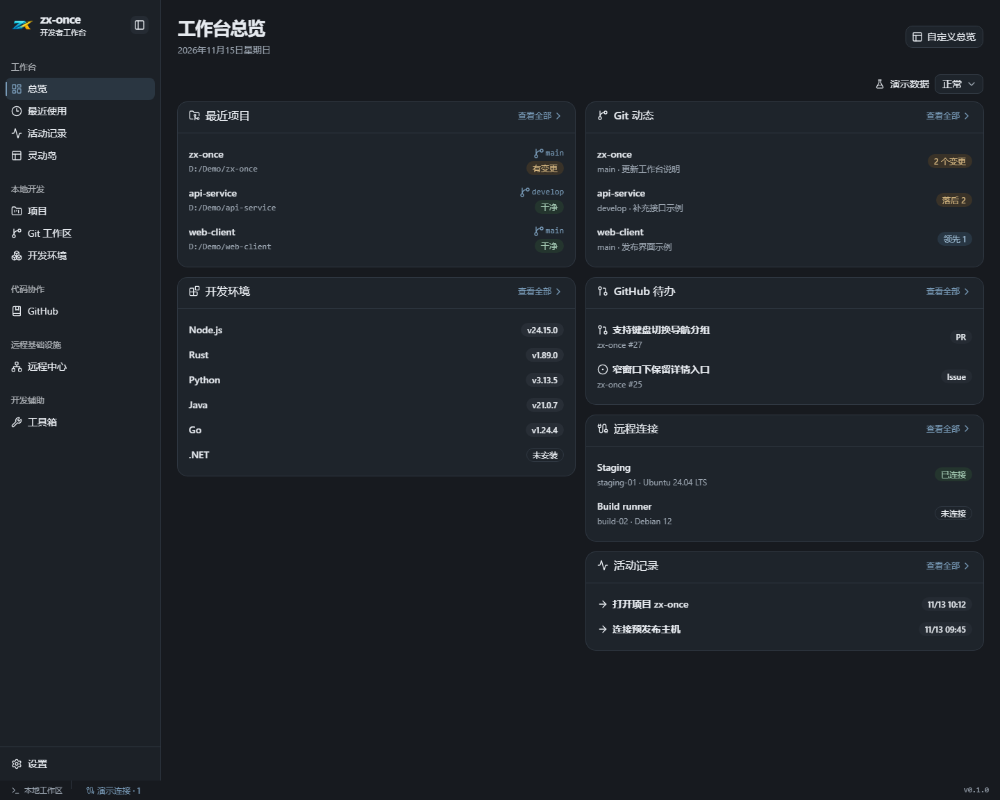
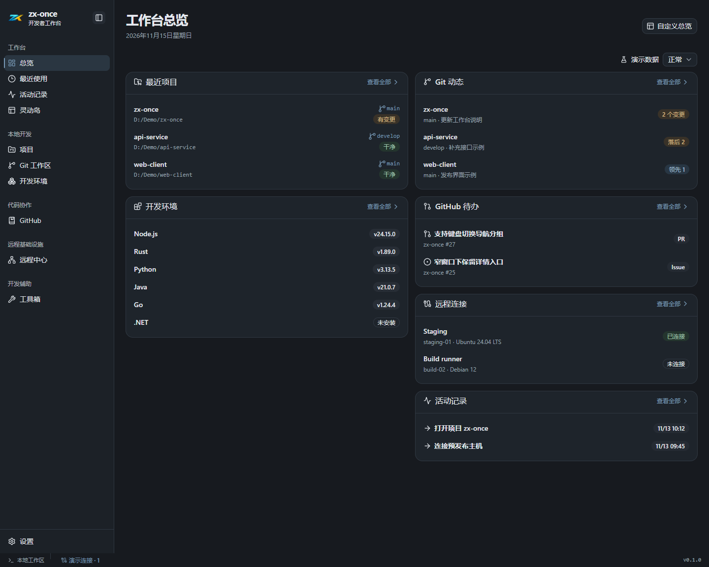

# 界面主题与配色

深色工作台使用纯中性石墨灰（Pure Neutral Graphite），基础色的 RGB 三个通道相等，主操作使用银灰色。浅色工作台沿用 Mineral Blue。「设置 → 外观」提供浅色、深色和跟随系统三种选项。HTML 入口在样式加载前读取偏好，工作台挂载后在跟随系统模式下监听系统外观变化。[主题初始化](../../../index.html) · [主题切换](../../../src/app/AppShell.tsx)

## 颜色变量

浅色值定义在 `:root`，深色值由 `:root.dark` 覆盖。StyleX 可以直接使用 `var(--card)` 等颜色。shadcn/ui 通过 Tailwind 的 `@theme inline` 将同一变量映射为 `bg-card`、`text-foreground`、`border-input` 和 `ring-ring` 等工具类。[主题变量定义](../../../src/styles.css)

固定页头内的标题为 1rem，二级导航为 0.8rem，正文和面板标题为 0.875rem。面板标题使用较高字重，资源路径和辅助文字使用较小字号。二级导航当前项用主题选中底色、细边框和字重标识，键盘焦点单独描边。[共享页面布局](../../../src/app/WorkbenchPage.tsx)

「设置 → 外观 → 半透明效果」中的百分比控制整个外框。桌面侧栏、底栏和圆角留白透出同一层背景，页头与正文共用实色圆角容器。浏览器用主题色作为外框的底层，窄窗抽屉叠在正文上，使用较实的底色和模糊效果。Windows 无法应用材质，或系统要求强制颜色、减少透明时，外框使用实色。[外观设置](../../../src/app/SettingsPage.tsx) · [表面样式](../../../src/styles.css)

| CSS 变量 | 浅色 | 深色 | 用途 |
| --- | --- | --- | --- |
| `--background` | `#F5F6F7` | `#181818` | 实色页头和页面内容区底色 |
| `--foreground` | `#20262D` | `#E6E6E6` | 标题、正文 |
| `--sidebar`、`--sidebar-background` | `#F0F2F4` | `#1D1D1D` | 一级导航与底部状态栏底色，以及 Windows 原生标题栏的目标底色 |
| `--sidebar-foreground` | `#20262D` | `#E0E0E0` | 侧栏文字 |
| `--card` | `#FFFFFF` | `#222222` | 普通面板、表单控件 |
| `--popover` | `#FFFFFF` | `#292929` | 菜单、弹窗、浮层 |
| `--secondary` | `#E9EDF1` | `#303030` | 次要操作、元数据徽章 |
| `--muted` | `#ECEFF2` | `#282828` | 普通徽章、悬停、骨架屏 |
| `--muted-foreground` | `#68727E` | `#A3A3A3` | 辅助文字、占位符 |
| `--accent` | `#E7EDF2` | `#303030` | 选中的导航、选项和切换控件 |
| `--accent-foreground` | `#20262D` | `#EAEAEA` | 选中项文字 |
| `--border` | `#DDE2E7` | `#383838` | 浮层边界、表格行分隔线 |
| `--input` | `#D5DCE3` | `#404040` | 输入框、次要按钮边界 |
| `--primary` | `#496F91` | `#D0D0D0` | 主操作、链接、选择标记 |
| `--primary-hover` | `#3F617F` | `#E0E0E0` | 主按钮悬停 |
| `--primary-foreground` | `#FFFFFF` | `#181818` | 主按钮文字、复选框勾号 |
| `--ring` | `#6486A3` | `#B8B8B8` | 键盘焦点 |
| `--overlay` | `#171A1F52` | `#000000A6` | Dialog 和 Sheet 遮罩，末两位为透明度 |
| `--scrollbar-thumb` | `#7D8791` | `#777777` | 原生滚动条滑块 |

### Windows 原生标题栏

应用名称右侧的返回、前进和主导航开关使用 18px 的 Lucide 线性图标。按钮以逻辑像素计，目标尺寸为 32 × 32，间距 3，圆角半径 8。Windows 原生工具栏随 DPI 缩放，可用高度较小时缩短按钮高度，避开顶部缩放区和右侧系统按钮。浏览器状态栏使用同样尺寸的 shadcn/ui Button。在浏览器强制颜色模式下，键盘焦点使用 2px 的系统 `Highlight` 轮廓。[原生标题栏布局](../../../src-tauri/src/caption_navigation/layout.rs) · [浏览器导航按钮](../../../src/app/WindowNavigation.tsx)

按钮默认只显示图标。悬停、侧栏展开和按下时，分别把 8%、12% 和 18% 的前景色混入底色，按下时反馈最明显。返回和前进不可用时，图标降至 40% 强度。按钮名称通过浮动提示显示。[原生按钮绘制](../../../src-tauri/src/caption_navigation/paint.rs)

Windows 主窗口首次创建和从托盘重建时均启用 WebView2 透明背景。`set_main_window_chrome` 按主题底色和透明度为窗口设置一层 Acrylic，并把窗口边框延伸到客户区。系统接受材质后，WebView 让桌面侧栏、底栏和内容区外的留白透出同一层材质。主窗口固定使用同一套活动外观，切换焦点不会修改选定的染色参数。[桌面入口](../../../src-tauri/src/lib.rs) · [窗口实现](../../../src-tauri/src/window_chrome.rs)

0% 表示实色，100% 表示原生材质最透的一档，染色 alpha 为 1/255。窗口使用显式的 Acrylic 染色策略，系统关闭透明效果或无法提供相应窗口属性时恢复实色。标题栏按钮逐像素合成图标和交互反馈，图标周围保留完整命中区域。高对比度模式使用系统配色。[原生材质](../../../src-tauri/src/window_chrome/accent.rs) · [标题栏按钮合成](../../../src-tauri/src/caption_navigation/layer.rs)

### 状态色

`--success`、`--warning`、`--destructive` 和 `--info` 用于文字和图标，对应的 `-muted` 用于徽章底色。状态同时保留文字或图标。类型、时间、分支名和版本号使用中性徽章。

| 状态 | 浅色文字 / 底色 | 深色文字 / 底色 | 界面示例 |
| --- | --- | --- | --- |
| Success | `#396A52` / `#E7F0EB` | `#A5B9AD` / `#28312C` | 已安装、已连接、工作区干净 |
| Warning | `#795924` / `#F4EEE2` | `#C2B299` / `#34312B` | 工作区有变更、分支落后 |
| Destructive | `#98474B` / `#F6E9E9` | `#CAA8A8` / `#362D2D` | 读取失败、部署失败、确认移除 |
| Info | `#456987` / `#E6EEF4` | `#A8B9C6` / `#2B3035` | 传输排队、分支领先 |
| Neutral | `foreground` / `muted` | `foreground` / `muted` | 普通 Badge，次要变体使用 `secondary-foreground` / `secondary` |

## shadcn/ui 映射

- `card-foreground`、`popover-foreground` 和 `secondary-foreground` 共用 `foreground`。深色主题为侧栏和选中项指定了独立的文字灰阶。
- `sidebar-primary`、`sidebar-primary-foreground`、`sidebar-accent`、`sidebar-accent-foreground`、`sidebar-border`、`sidebar-ring` 分别引用同名的基础角色。导航用 `sidebar-accent` 铺底，2px 侧标及图标取 `sidebar-primary`。
- 深色图表的五级系列色为 `#D0D0D0`、`#A3A3A3`、`#848484`、`#686868`、`#4C4C4C`。深色文本选区复用主按钮的前后景色。

| 组件或场景 | 使用的颜色 |
| --- | --- |
| Button、Checkbox、Slider | 主按钮和勾选用 `primary` / `primary-foreground`。滑轨用 `muted`，已填部分用 `primary`，拖柄用 `card` 和 `ring` |
| Input、Textarea、Select、Field | 控件用 `card` 和 `input`，焦点用 `ring`，错误用 `destructive` |
| Tabs、Toggle、Sidebar | 中性悬停，选中项使用 `accent` 或 `card` 底色，配合主色描边、图标或选中标记 |
| ContextMenu、Select 列表、Dialog、Sheet、Toast | 面板取 `popover` / `popover-foreground`，浮层边界取 `border`，模态遮罩取 `overlay`。深色菜单和列表用 1px 的 `ring` 内描边标出鼠标或键盘高亮项。Toast 按结果给图标着色 |
| Tooltip | 反相中性色 `foreground` 底、`background` 字，箭头与底色一致 |
| Badge、Alert | 普通信息取中性色，业务状态显式指定对应变体 |
| Card、Item、Table、Skeleton | 卡片取 `card`，行悬停取中性表面，分隔线取 `border`，骨架取 `muted` |

工作台通过 Checkbox、ToggleGroup 和 Select 提供选择控件，通过 ContextMenu 展示右键菜单，通过 Dialog 承载确认操作，滚动区域使用原生滚动条。项目中没有独立的 Radio、Switch、DropdownMenu、Popover、AlertDialog 或 ScrollArea 组件。

## 带色相内容的范围

灵动岛设置页和预览画布的外框跟随工作台主题。岛体背景、边框和主题由 `IslandConfig.appearance` 独立控制。预览保留岛体文字和控件原有的灰调、媒体封面与占位渐变、充电绿 `#21EB54` 和低电量红 `#F23046`。`#101214`、`#202326` 用于识别旧版岛体默认背景。[预览配色](../../../src/features/island/settingsStyles.ts) · [岛体默认配置](../../../src/features/island/defaults.json)

深色主题中，菜单、导航、链接和普通徽章均使用灰阶。

## 总览截图

以下截图记录了侧栏布局调整前的配色。两张深色截图使用相同的总览数据和 1440 × 1152 的 Chrome 视口。截图时关闭了 LCD 子像素渲染，避免显示器相关的文字色边影响比较。[浅色总览](overview-light.png)

| 调整前 | 纯中性石墨灰 |
| --- | --- |
|  |  |
